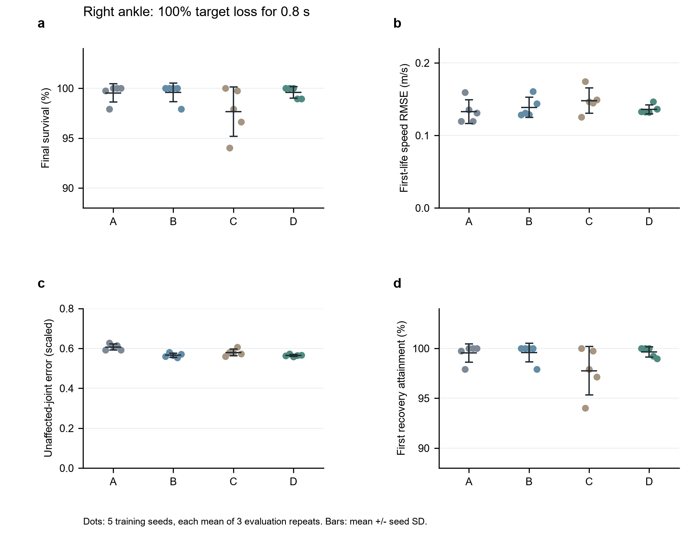
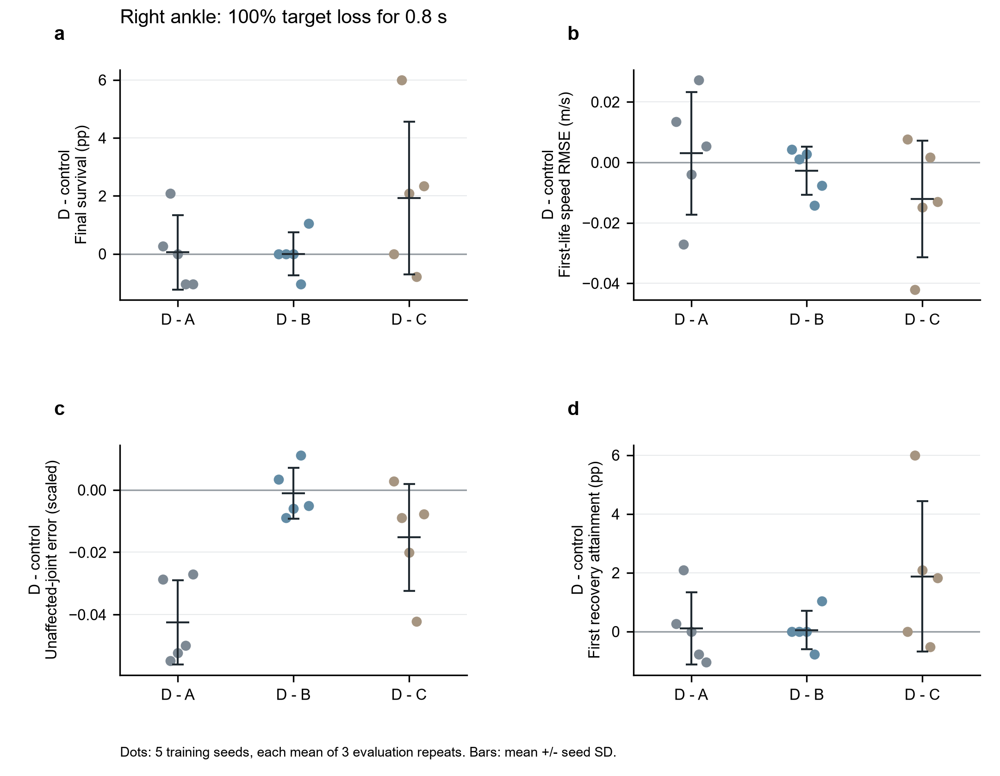
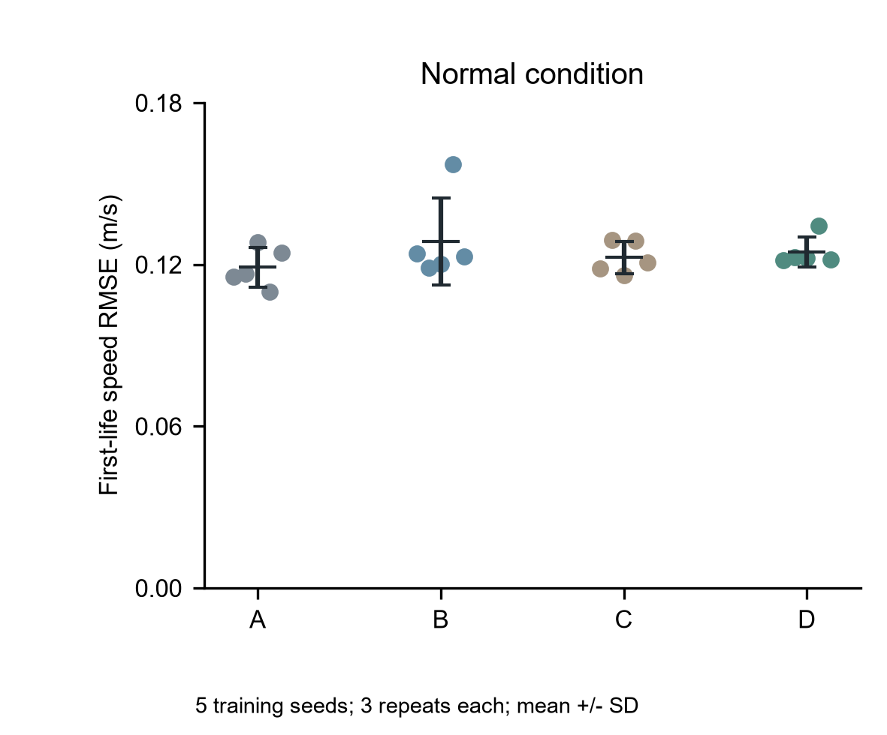

# G1间歇目标丢失实验：2026年11月3日阶段成果

**实验训练与正式评价已经完成；选择性放松相对固定参考约束的稳定优势仍未得到充分支持，不能宣布原研究主张已经证成。**

20个模型各从对应v1父2000更新追加1000到3000；四组×五训练种子×三匹配评价种子×四场景=240案例全部完成。每例128环境、20秒。正式评价完成UTC：2026-11-03T11:29:54.578086+00:00。

A无模仿约束，B固定模仿约束，C整体放松，D局部选择性放松与平滑恢复；C/D按相同trace匹配总权重质量。故障是新关节目标间歇丢失、保持上一已应用目标，并非物理关节角度锁死。训练仍是平地、单参考、固定速度，同时受影响1–2个下肢关节。

## 统计口径

先对每个训练种子的三个匹配评价记录等权取均值，再对五个训练种子计算均值与样本SD（ddof=1）。下表误差是每案例RMSE的均值，不是汇总原始帧后重算的RMSE。128环境和三评价种子均不是额外独立训练重复。未删除失败种子或真实跌倒，全部5配对差保存在CSV。CSV/JSON中的比例及比例差保留0–1 fraction单位，本文与图中分别乘100显示百分比及百分点；其余误差保留原单位。

本报告是开发性、描述性分析；没有事后新增达标阈值、显著性检验或非劣性界限，不将未检出优势解释为等效或无效。样本仅五训练种子，范围/SD不是置信区间。

## 四场景完整结果

|场景|组|最终存活%（均值±种子SD）|首生命速度RMSE m/s|故障期未故障关节参考误差 scaled|首次恢复达标%|描述性跌倒次数|
|---|---|---:|---:|---:|---:|---:|
|正常|A|100.00000 ± 0.00000|0.11893 ± 0.00735|不适用|不适用|0|
|正常|B|100.00000 ± 0.00000|0.12858 ± 0.01614|不适用|不适用|0|
|正常|C|100.00000 ± 0.00000|0.12259 ± 0.00596|不适用|不适用|0|
|正常|D|100.00000 ± 0.00000|0.12460 ± 0.00549|不适用|不适用|0|
|左膝75%/0.4秒|A|100.00000 ± 0.00000|0.11958 ± 0.00715|0.57448 ± 0.00798|100.00000 ± 0.00000|0|
|左膝75%/0.4秒|B|100.00000 ± 0.00000|0.12959 ± 0.01618|0.53602 ± 0.00130|100.00000 ± 0.00000|0|
|左膝75%/0.4秒|C|100.00000 ± 0.00000|0.12338 ± 0.00575|0.54321 ± 0.00444|100.00000 ± 0.00000|0|
|左膝75%/0.4秒|D|100.00000 ± 0.00000|0.12530 ± 0.00540|0.53623 ± 0.00708|100.00000 ± 0.00000|0|
|右踝75%/0.4秒|A|100.00000 ± 0.00000|0.12000 ± 0.00715|0.61744 ± 0.01289|100.00000 ± 0.00000|0|
|右踝75%/0.4秒|B|99.89583 ± 0.23292|0.12990 ± 0.01565|0.57157 ± 0.00665|99.94792 ± 0.11646|2|
|右踝75%/0.4秒|C|100.00000 ± 0.00000|0.12382 ± 0.00608|0.58637 ± 0.00953|100.00000 ± 0.00000|0|
|右踝75%/0.4秒|D|99.79167 ± 0.33954|0.12658 ± 0.00560|0.57174 ± 0.01344|99.79167 ± 0.33954|4|
|右踝100%/0.8秒|A|99.53125 ± 0.90960|0.13291 ± 0.01639|0.60704 ± 0.01508|99.53125 ± 0.90960|9|
|右踝100%/0.8秒|B|99.58333 ± 0.93169|0.13867 ± 0.01389|0.56555 ± 0.01082|99.58333 ± 0.93169|8|
|右踝100%/0.8秒|C|97.65625 ± 2.46366|0.14801 ± 0.01753|0.57971 ± 0.01681|97.76042 ± 2.41921|45|
|右踝100%/0.8秒|D|99.58333 ± 0.57054|0.13590 ± 0.00622|0.56449 ± 0.00515|99.63542 ± 0.50765|8|

每组每场景为5模型×3评价×128=1920条模拟轨迹，仅作描述性分母。故障从6秒起，轻故障0.4秒、严重0.8秒。全场景指标、每案例分母、首生命参考误差及故障窗口速度误差见原始CSV和完整统计JSON。

## 主张的证据与边界

严重右踝中D与B的平均最终存活率相同（均约99.5833%），D的首生命速度及未故障关节参考误差均值略低；这些小差异和五种子间方向必须一起评估，不能仅用均值宣布选择性机制胜出。相对C，D平均存活、速度、参考指标较好，但C的单个较差种子影响较大；全部配对差而非挑选一个种子是解释依据。轻右踝中D有4次、B有2次跌倒，不能用严重场景的较好均值掩盖轻故障取舍。

下表列严重故障的全部配对差摘要；差值均为D减对照，存活/恢复正值较好，误差负值较好。种子完整差值见paired_seed_differences.csv。

|比较|指标|平均差|种子差最小–最大|有利/持平/不利种子|
|---|---|---:|---:|---:|
|D-A|20秒最终存活率|0.052083百分点|-1.041667–2.083333|2/1/2|
|D-A|首生命速度RMSE(m/s)|0.002993|-0.027041–0.027182|2/0/3|
|D-A|故障期未故障关节参考误差(scaled)|-0.042558|-0.054820–-0.027059|5/0/0|
|D-A|跌倒前首次达到恢复窗比例|0.104167百分点|-1.041667–2.083333|2/1/2|
|D-B|20秒最终存活率|0.000000百分点|-1.041667–1.041667|1/3/1|
|D-B|首生命速度RMSE(m/s)|-0.002771|-0.014273–0.004244|2/0/3|
|D-B|故障期未故障关节参考误差(scaled)|-0.001066|-0.008917–0.011085|3/0/2|
|D-B|跌倒前首次达到恢复窗比例|0.052083百分点|-0.781250–1.041667|1/3/1|
|D-C|20秒最终存活率|1.927083百分点|-0.781250–5.989583|3/1/1|
|D-C|首生命速度RMSE(m/s)|-0.012109|-0.042046–0.007619|3/0/2|
|D-C|故障期未故障关节参考误差(scaled)|-0.015227|-0.042194–0.002723|4/0/1|
|D-C|跌倒前首次达到恢复窗比例|1.875000百分点|-0.520833–5.989583|3/1/1|

首次恢复比例的代码含义：在首次跌倒之前曾达到连续0.1秒的相对速度恢复阈值窗；达到后再跌倒不会撤销该记录。因此它可能高于20秒最终存活率，不能写成全20秒无跌倒保证。恢复相对基线、阈值至少0.25m/s或基线加0.15m/s，也不代表绝对跟踪完美。

故障窗口和故障后参考误差按存活样本计算，原则上存在筛选可能。本次全部故障案例的故障窗入口、出口均为128，故障窗样本完整，未发生窗内死亡选择；实际选择主要出现在首生命和故障后窗口。首生命误差虽排除重置后的新生命，较早跌倒仍会缩短分母。valid_sample_denominators.json保留每案例实际帧数、有限样本和恢复eligible数，最终存活与条件误差必须并列。参考误差为scaled代理，不能证明视觉自然性。

软件机制、父检查点和精确恢复证据合格，证明实现按设定执行，不等于研究效果优于对照。G与v1同时改变追加预算和故障分布，仅作描述；E8不纳入公平主比较。单冻结参考、平地、固定速度、模拟器开发实验不能冒称独立参考验证、复杂地形、实机或普遍有效性。

## 图表

每点一个训练种子，先平均三个评价重复；黑横线和误差棒为五种子均值±样本SD。严重场景存活与恢复纵轴为88–104%，明确截取高存活区以便显示种子差，SD误差棒可超过100%但不代表实际概率超过100%；全部实际百分比另在表格给出。配对图单位为百分点或原误差单位，不使用显著性星号。

## 交付状态

训练20/20、正式评价240/240、描述性分析与图表已生成。离机完整成果包需另外核验全部ZIP、SHA256、CRC和必要成员覆盖；本报告本身不等于完整模型离机备份，不代表可释放云端实例。后续强化、换粗糙地形或新参考均延后，须另立协议。

复现：Python运行analyze_g_stage.py，提供完整最终采集JSON与输出目录；绘图仅依赖matplotlib/numpy，随包提供audit_panel_alignment.py。原始记录、协议、最终模型清单、全部训练种子均值、组统计、配对差、分母和输入SHA均已保留。

流程软件参考：Kassis T, Agarwal V, He Y, Patel D, Brueckner AM. Scientific Agent Skills: A Library of Procedural Knowledge for Research Agents. 2026. arXiv:2609.00065, DOI:10.48550/arXiv.2609.00065（元数据2026-11-03核验；仅统计流程来源，不作为G1效果证据）。
