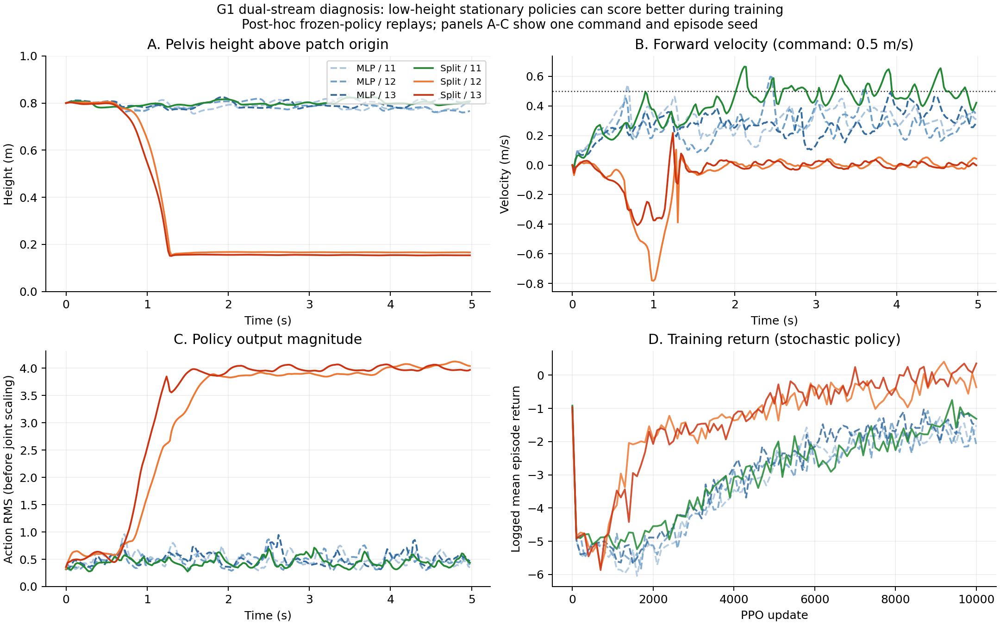

# G1 terrain-scan full screening：结果与失败机制诊断

本次训练对象为 Unitree G1 双足人形，任务为 `Unitree-G1-Rough`。六个 run 均完成 10001 次更新（每次 512×24 个 transition）。三种子配对的平均 RMSE 相对改善为 −48.81%；判定为 `NEXT_EXPERIMENT`，当前实现未显示优于 matched baseline。

公开文件包括筛查协议 [`protocol.json`](protocol.json)、holdout 实际执行协议 [`holdout/protocol.json`](holdout/protocol.json)、配对结果 [`holdout/summary.json`](holdout/summary.json)、判定 [`holdout/decision.json`](holdout/decision.json) 和六份脱敏训练 manifest。holdout 协议将开发与 holdout episode seed 更新为 `20262601`；两份协议及副本哈希均保留。

## 原始主结果

主指标为 clean 场景平面速度 RMSE，越低越好；相对改善定义为 `(matched − semantic) / matched`。

| 训练种子 | matched MLP | semantic 双流 | 相对改善 |
|---|---:|---:|---:|
| 20261111 | 0.295671 | 0.268411 | +9.22% |
| 20261112 | 0.332509 | 0.562487 | −69.16% |
| 20261113 | 0.296525 | 0.552952 | −86.48% |

三种子配对相对改善均值为 −48.81%；两方法的 RMSE 算术均值分别为 0.308235 和 0.461283 m/s。当前实现未支持“双流在匹配预算下更好”的主张，不能把单个成功种子当作整体有效证据。三对训练种子是独立重复，episode 不应被当作独立训练重复；本报告不作统计显著性或普遍无效的结论。

CPU ONNX Runtime float32、单线程、batch=1、每模型 2000 次：matched p50 为 17.79–28.70 μs，semantic 为 21.21–32.29 μs。共享机器、频率变化等限制意味着这些数字不能直接当作机器人端性能。

## 已确定的失败行为

对所有六个冻结模型进行了同配置的事后诊断回放，新增记录骨盆位置、倾角、关节、动作、奖励分项和观测。本公开目录包含 holdout 汇总、诊断汇总、ablation 汇总和图表；逐回合原始输出及诊断时序数组不在公开包中。

以下为 clean 六个命令的最后两秒均值。高度相对各地形块的 origin，动作 RMS 是关节缩放前的网络输出，不是米或关节角。

| 模型 | 骨盆高度 m | 前向速度绝对值 m/s | 动作 RMS | 末期训练总回报 |
|---|---:|---:|---:|---:|
| matched / 11 | 0.796 | 0.262 | 0.479 | −1.668 |
| matched / 12 | 0.792 | 0.183 | 0.459 | −1.793 |
| matched / 13 | 0.799 | 0.244 | 0.500 | −1.335 |
| semantic / 11 | 0.798 | 0.335 | 0.448 | −1.216 |
| semantic / 12 | 0.164 | 0.013 | 4.069 | −0.011 |
| semantic / 13 | 0.160 | 0.016 | 3.830 | +0.037 |

两个失败种子都出现低姿态、近停滞、大动作输出。倾角约 14°/20°，没有触发 70° 的朝向终止。仅从位置和关节记录不能精确认定哪块身体在承重，因而不用“坐倒”或“四足行走”作已验证标签。

训练回报取 TensorBoard 9000–10000 更新的均值，按更新编号保留后写入记录，处理恢复产生的重复。它来自带探索噪声的训练过程，与确定性回放的逐步奖励不是同一统计量。失败种子的训练回报反而较高，说明在这批实际训练中，总回报排序与目标运动质量不一致；这不是对奖励全局最优解的证明。

## 证据最强的机制：奖励和失败判据允许退化策略

- `fell_over` 只检查朝向超过 70°，没有骨盆过低、非足部支撑、带运动命令却长期停滞的失败检查。故“存活 100%”不能等同正常站立/行走。
- 速度奖励为指数型核。停滞的策略在较小目标速度下仍获正奖励；低转动、低滑动也能减少若干惩罚。不能只盯着某一项有“速度”名称，就认为总目标保证移动。
- `pose` 是 `exp(-mean(error²/std²))` 的正奖励，严重偏离后趋近于零，没有随偏离继续增大的惩罚。在失败模型的确定性回放后半段，该项接近零，但 episode 仍继续。
- `stand_still` 的实际含义是“低速度命令下保持默认关节姿态”，它仅在命令很小时启用；不是“有运动命令但不动就惩罚”。六个 clean 命令下该项为零。
- `action_rate_l2` 罚相邻动作的变化，不罚恒定动作的幅值。动作未设 clip，也无直接 action L2；实际关节越界仍有惩罚，不能说动作完全不受约束。
- `foot_gait` 检查接触与周期 stance 的匹配比例，不要求前进或正常骨盆高度。固定接触也能得到部分奖励。失败回放中的加权 gait 项约 0.356，故它没有将退化行为排除。

训练指标在约 500–2000 更新已分岔。到 9000–10000：成功双流的 pose/线速度奖励为 0.377/0.442，两个失败双流为约 0.045/0.326；action-rate 惩罚分别约 −1.151 和 −0.770。训练总回报较高，但最终确定性回放仍出现低姿态停滞；目前没有中间 checkpoint 的姿态回放，不能断言整个训练期间从未出现正常行走。因此继续加长同一配置没有证据保证改善。

## 双流实现为什么可能更易走向坏策略

现有实现是一次早期分组编码后拼接：`98→480` 与 `187→32`，然后 `512→256→128→29`。matched 是 `285→341→256→128→29`，可训练参数分别 221530 和 221744，差约 0.10%。

实现沿用了原先“93 维状态＋5 维 command/phase”实验中的 480/32 宽度。改为 187 维地形输入后，地形仍只有 32 维瓶颈；输入占 65.6%，融合前特征只占 6.25%。地形第一层映射的秩上限为 32，本体与地形也在该层无法交互。这些是确定的结构事实，但比例和秩本身不能证明 32 维一定不够。

因此当前实验同时改变了信息压缩、容量分配和交互时机，没有单独识别“语义分流”的因果效果。编码器也没有额外的地形重建、落脚预测或分支利用监督；仅靠 PPO 总回报，不保证小分支学到对落脚有效的地形表征。原始 full 阶段缺少 random-split、不同宽度或融合位置对照，故不能把全部差距唯一归因于瓶颈或双流概念。

## 冻结模型的地形干预

对六个最终模型各做两项事后诊断：用该模型训练 normalizer 的地形均值替代 scan，以及固定随机排列 187 个扫描点。保持权重冻结，不重训。这些输入可能偏离训练分布，属于机制探索，不作为新确认性主结果。

| semantic 种子 | 同批未干预诊断 RMSE | 均值 scan RMSE | 均值 scan 后骨盆高度 | 打乱 scan RMSE |
|---|---:|---:|---:|---:|
| 11 | 0.274 | 0.346 | 0.794 m | 0.491 |
| 12 | 0.563 | 0.518 | 0.163 m | 0.610 |
| 13 | 0.551 | 0.552 | 0.153 m | 0.646 |

成功种子对 scan 干预敏感，不能说地形完全没有被利用。失败种子即使屏蔽地形仍低姿态停滞，说明仅修改推理输入不能救回已学到的策略；这不排除地形分支在训练期间影响了优化路径。原始同配置重放的六个 clean RMSE 为 0.278/0.327/0.299/0.274/0.563/0.551，与原始结果非逐位一致，但保留相同失败分型；小幅差异不作机制证据。`spatial_permutation_scan` 的 semantic12 有一个回合终止，其后自动 reset 状态的高度统计不作有效姿态结论。

## 已检查但不能作为主因的解释

- 六个 run 已完整训练、checkpoint/ONNX 哈希与评测绑定一致，导出 parity 通过，无非有限 PPO loss。
- 同一训练种子下 shared env/agent、critic 初始化与 startup physics 哈希一致，观测确为 98＋187，模型为 G1 双足。
- semantic12 没有恢复过程却失败；semantic11 恢复过却成功，所以迁移/续训不是共同充分原因。恢复仍会重置物理状态，不声称完整轨迹等价。
- 地形 generator 的 seed 为 None 不等于使用不可控系统熵：已查 mjlab 的实现会从已 seed 的 NumPy RNG 取整数。但 extero 路径未保存原始地形/出生状态的精确配对快照，后续应补充。
- 已发现推扰评测缺陷：回合 5 秒、推扰也在 5 秒，实际循环没有执行触发步。原 push 结果不能支持抗推能力；这个问题不解释 clean 的低姿态退化。

## 最小验证顺序（尚未启动新长训）

1. 先将低高度/非足支撑/停滞诊断纳入开发评测，修正推扰触发时刻并核验真实扰动。保持原始结果不变，冻结新版本协议。
2. 用已记录的正常与退化轨迹审查奖励分解，确定符合 G1 双足目标的失败条件和奖励修订；matched 与 semantic 同时使用，避免只对方法有利。动作约束要按关节尺度和实际目标审定，不能盲目设统一 clip。
3. 单独验证结构：在相同训练规则下比较当前 480/32 与更充分的地形宽度，重新匹配总参数；随后独立比较融合时机。每次只改一个因素，加入 random-split 以识别语义分组本身。
4. 在开发集监测骨盆高度、速度执行、动作幅值与奖励，发现稳定退化即报告。最终仍需跨训练种子及多个地形/episode seed 的冻结 holdout，不能反复看原 holdout 调参后继续称其为未见测试集。

当前最有证据的解释是：奖励和失败判据允许低姿态停滞策略，当前双流在三次训练中的两次进入了该策略区域；结构瓶颈可能影响进入坏解的概率，但尚未被因果消融证实。应先纠正任务目标与有效行走的对齐，再检验分流的独立价值。

原始 checkpoint、ONNX 模型、训练日志、逐回合数组及完整诊断脚本保存在研究归档中，不随本公开摘要分发。这里提供协议、聚合结果、脱敏训练 manifest、冻结训练脚本快照、诊断图及文件哈希；原始训练与 holdout 结果未被覆盖。文件来源和副本哈希见 [PROVENANCE.json](PROVENANCE.json)。
